# Hi, I'm Shang Qi 👋

**商棋 · AI 产品经理**

<a href="https://tophung48162-cell.github.io/">
  <picture>
    <source media="(prefers-color-scheme: dark)" srcset="assets/portfolio-launch-dark.svg" />
    <source media="(prefers-color-scheme: light)" srcset="assets/portfolio-launch-light.svg" />
    
  </picture>
</a>

点击上方工作台，进入我的个人网站。

我关注 **AI 如何进入真实工作场景**。从一个具体问题出发，理解需求、梳理流程，再把想法做成可以体验的原型。

我也写文章。把模型、知识库和产品实践里的复杂问题，整理成更容易理解的文字。在做产品和写作之间，持续校准自己的判断。

🌐 [个人网站](https://tophung48162-cell.github.io/) · 🧩 [全部项目](#projects) · 🛠 [技能与标签](#skills) · ✍️ [文章与思考](#writing)

`AI 产品经理` `产品研究` `RAG 与知识库` `模型评测` `原型搭建` `技术写作`

---

## 🧩 项目 · Projects

从知识服务到创作工具，把产品想法变成可以查看和体验的作品。这里收录了我的 **5 个项目**，以及本页的维护仓库。

### 🧠 [知枢 · 企业知识中台](https://github.com/tophung48162-cell/enterprise-rag-hub)

让企业资料走进 AI 的回答。围绕知识导入、文档分块、检索与重排、问答应用和运行追踪，串联 RAG 知识服务流程。

**实践重点：** 知识库产品设计、RAG 流程、检索与问答可观测性。 
**当前状态：** 开发中原型，含后端实现与演示回退；真实云服务及完整基础设施仍在验证。

React · TypeScript · FastAPI · LangChain 
[查看项目 →](https://github.com/tophung48162-cell/enterprise-rag-hub)

### 🗂 [诉状工作人员后台](https://github.com/tophung48162-cell/lawsuit-staff-admin)

把案件办理、收退款台账和统计报表放进一个工作台，并适配手机端使用。围绕实际业务流程组织功能与数据。

**实践重点：** 业务需求梳理、状态流转、数据台账与移动端体验。 
**当前形态：** 包含服务端与数据库实现的业务工具。

React · TypeScript · Vinext · Cloudflare Workers · D1 
[查看项目 →](https://github.com/tophung48162-cell/lawsuit-staff-admin)

### ✒️ [留白 · 言情写作](https://github.com/tophung48162-cell/liubai-romance)

把中文言情短篇的写作方法整理为可安装的 Skill，配套提示词生成、示例切换与下载页面，让一套创作方法可以反复使用。

**实践重点：** Prompt 设计、Skill 封装与创作流程。 
**当前形态：** 写作 Skill + 静态交互页面；小说生成由支持 Skill 的助手完成。

HTML · CSS · JavaScript · Codex Skill 
[查看项目 →](https://github.com/tophung48162-cell/liubai-romance)

### 🧊 [Keep · 运动主题交互展示](https://github.com/tophung48162-cell/keep-motion)

用冰屋场景、可点击冰块和粒子字形，探索 3D 场景、滚动叙事与声音交互的组合。

**实践重点：** 视觉表达、交互探索与页面体验。 
**项目性质：** 基于第三方引擎及视觉素材的非商业学习展示。

HTML · JavaScript · 3D 场景 · 粒子交互 
[在线体验 ↗](https://tophung48162-cell.github.io/keep-motion/) · [查看项目 →](https://github.com/tophung48162-cell/keep-motion)

### 🌐 [商棋 · 个人网站](https://github.com/tophung48162-cell/tophung48162-cell.github.io)

用白色画廊式页面展示个人介绍、AI 产品关注方向和思考手记。关注清晰的内容层次、响应式布局和轻量交互。

**实践重点：** 个人信息架构、视觉规范、移动端适配与发布。 
**当前状态：** 已通过 GitHub Pages 发布。

HTML · CSS · JavaScript · GitHub Pages 
[访问网站 ↗](https://tophung48162-cell.github.io/) · [查看项目 →](https://github.com/tophung48162-cell/tophung48162-cell.github.io)

**🪪 [GitHub 个人主页配置](https://github.com/tophung48162-cell/tophung48162-cell)** 
本页的 README、工作台视觉和项目、文章入口，在这个仓库持续维护。

[浏览全部 6 个公开仓库 →](https://github.com/tophung48162-cell?tab=repositories)

---

## 🛠 技能与标签 · What I work with

### 产品与 AI

- **产品研究与设计**：场景梳理、需求分析、业务流程、功能设计与原型验证。
- **AI 应用与知识库**：RAG 流程、知识组织、检索与引用、Prompt 设计、Skill 设计与封装。
- **模型评测与选型**：从真实任务设计评价标准，关注完成质量、成本和体验边界。
- **技术内容写作**：用通俗文字解释技术机制，整理模型观察、产品体验和实践思考。

### 原型与实现

借助 AI 编程工具，把产品想法做成可交互页面，连接前后端流程，并通过 GitHub 管理和发布。以下技术已用于我的公开项目：

**界面** &nbsp; `React` `TypeScript` `JavaScript` `HTML / CSS` `Vite` 
**AI 与服务端** &nbsp; `FastAPI` `LangChain` `Cloudflare Workers` `D1` 
**发布与协作** &nbsp; `Git` `GitHub` `GitHub Pages`

---

## ✍️ 文章与思考 · Writing

从技术机制到产品选择，记录我对 AI 的观察。关注 **开源生态、RAG、模型评测与真实使用体验**。

### [DeepSeek 把模型背后的“发动机”也开源了](https://mp.weixin.qq.com/s/C6J4u0Zc45dgEdhTqjDnWg)

`AI 技术观察` `开源生态` · 微信公众号 
[阅读原文 ↗](https://mp.weixin.qq.com/s/C6J4u0Zc45dgEdhTqjDnWg)

---

## 关于我 · About

- **职业**：AI 产品经理。
- **关注**：让技术能力转化为清晰、可用的产品体验。
- **实践**：做原型、做验证，也把过程中的观察写下来。

**保持好奇，让想法慢慢成形。** 
[在我的个人网站继续了解 →](https://tophung48162-cell.github.io/)
