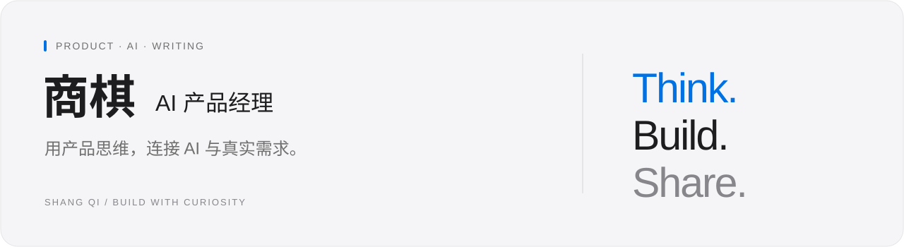

  

  <a href="https://tophung48162-cell.github.io/"><strong>个人网站</strong></a>
  &nbsp; · &nbsp;
  <a href="#projects"><strong>项目全览</strong></a>
  &nbsp; · &nbsp;
  <a href="#skills"><strong>技能与实践</strong></a>
  &nbsp; · &nbsp;
  <a href="#writing"><strong>文章与思考</strong></a>

你好，我是 **商棋**，一名 **AI 产品经理**。

我关注 AI 如何进入真实工作场景：从需求和问题出发，把想法做成可以体验的产品原型，再用具体任务检验它是否有用。我也持续写作，记录对模型、产品和技术变化的观察。

  <code>AI 产品经理</code> <code>产品研究</code> <code>RAG 与知识库</code> <code>模型评测</code> <code>原型搭建</code> <code>内容写作</code>

## 🧩 项目全览

目前的 **5 个公开项目**，覆盖知识服务、业务工具、创作辅助、交互探索和个人展示。

| 项目 | 做什么 | 当前形态 | 入口 |
| :--- | :--- | :--- | :--- |
| **知枢 · 企业知识中台** | 围绕知识导入、文档分块、向量检索、问答应用和运行追踪，探索企业 RAG 知识服务流程。 | 开发中原型，含后端实现与演示回退 | [查看项目](https://github.com/tophung48162-cell/enterprise-rag-hub) |
| **诉状工作人员后台** | 面向诉状服务的案件管理工作台，包含办理状态、收退款台账、统计报表与手机端界面。 | 业务工作台，含服务端与数据库实现 | [查看项目](https://github.com/tophung48162-cell/lawsuit-staff-admin) |
| **留白 · 言情写作** | 将中文言情短篇的写作方法整理为可安装的 Skill，配套提示词生成、示例切换和下载页面。 | 写作 Skill + 静态页面 | [查看项目](https://github.com/tophung48162-cell/liubai-romance) |
| **Keep · 运动主题交互展示** | 通过 3D 场景、可点击冰块和粒子字形，探索滚动叙事与声音交互。 | 非商业学习展示，使用第三方视觉素材 | [查看项目](https://github.com/tophung48162-cell/keep-motion) · [在线体验](https://tophung48162-cell.github.io/keep-motion/) |
| **商棋 · 个人网站** | 用白色画廊式页面展示个人介绍、AI 产品关注方向与思考手记。 | 已发布的静态网站 | [查看项目](https://github.com/tophung48162-cell/tophung48162-cell.github.io) · [访问网站](https://tophung48162-cell.github.io/) |

<strong>展开查看各项目的技术与实践重点</strong>

| 项目 | 技术与工具 | 实践重点 |
| :--- | :--- | :--- |
| 知枢 | React · TypeScript · Vite · Ant Design · FastAPI · LangChain | RAG 流程、知识处理、检索与重排、问答追踪；真实云服务和完整部署仍在验证中 |
| 诉状工作人员后台 | React · TypeScript · Vinext · Cloudflare Workers · D1 · Drizzle ORM | 业务流程、数据台账、统计展示和移动端适配 |
| 留白 | HTML · CSS · JavaScript · Codex Skill | 写作方法沉淀、提示词设计、可复用 Skill 与交互页面 |
| Keep | HTML · JavaScript · 3D 场景与粒子交互 | 基于现有引擎和素材的视觉交互学习 |
| 个人网站 | HTML · CSS · JavaScript · GitHub Pages | 视觉规范、响应式布局、原生交互和持续发布 |

[浏览全部公开仓库 →](https://github.com/tophung48162-cell?tab=repositories)

## 🛠 技能与实践

| 方向 | 我关注和实践的内容 |
| :--- | :--- |
| **产品研究与设计** | 场景梳理、需求分析、业务流程、功能设计、原型验证 |
| **AI 应用与知识库** | RAG 流程、知识组织、检索与引用、Prompt 设计、Skill 设计与封装 |
| **模型评测与选型** | 从真实任务设计评价标准，关注完成质量、使用成本和体验边界 |
| **原型与落地** | 借助 AI 编程工具制作可交互页面，连接前后端流程，通过 GitHub 管理与发布 |
| **技术内容写作** | 用通俗文字讲解技术机制，整理 AI 产品体验、模型观察和个人思考 |

**项目中使用的技术**

`React` `TypeScript` `JavaScript` `HTML / CSS` `Vite` `FastAPI` `LangChain` `Cloudflare Workers` `D1` `Git / GitHub Pages`

## ✍️ 文章与思考

我把研究和实践中的问题写下来，关注模型、开源生态、RAG、评测选型，以及 AI 如何改变日常工作。

| 文章 | 方向 | 阅读 |
| :--- | :--- | :--- |
| **DeepSeek 把模型背后的“发动机”也开源了** | AI 技术观察 · 开源生态 | [微信公众号原文](https://mp.weixin.qq.com/s/C6J4u0Zc45dgEdhTqjDnWg) |

---

  <strong>保持好奇，让想法慢慢成形。</strong> 
  <a href="https://tophung48162-cell.github.io/">tophung48162-cell.github.io</a>

